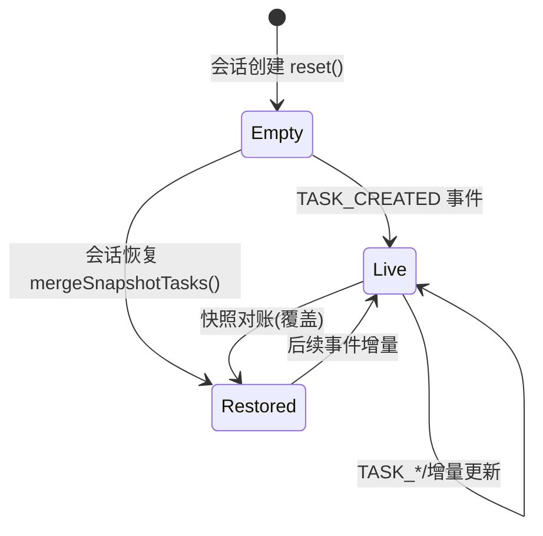

# 架构设计文档 - Story 9.44

**Story:** 多Agent协作统一任务看板（Multica模式）
**版本:** 1.0
**最后更新:** 2026-10-12

---

## 🏗️ 架构概览

### 设计目标

在**不改引擎执行逻辑**的前提下，为多 Agent 协作窗口补齐任务看板 UI。核心思路：协作运行时已经产出完整任务数据（黑板任务 + `TASK_*` 事件 + `AgentTaskSnapshot` 快照 + `/snapshot` 只读 API），本 Story 只做「数据 → 界面」的呈现层接线，并新增一条 Electron IPC 快照通道补齐双通道能力。另外新增一个独立的通知挂点：`HUMAN_REVIEW_REQUEST` 事件触发时写入 OriginOS 通知中心（复用既有 `NotificationManager`）。

### AGENTS.md 规约符合性声明

本设计符合 [AGENTS.md](../../../AGENTS.md) 的以下规约：
- ✅ 技术栈约束（第 2 章）：仅用 React + TS + Tailwind + Zustand
- ✅ 目录结构规约（第 3 章）：UI 归 `collaboration-runtime/ui/`，服务归 `lib/integrations/electron/services/`，IPC 通道归 `ipc-protocol.ts`；Web 侧 `app/api/` 仅做参数转发（现有 route 模式一致）
- ✅ 模块依赖规约（单向按序依赖）：ui/ 位于 core modules 内，经既有 services 抽象访问 IPC/HTTP；无跨包相对路径穿透，新增 core 深路径不进 exports 白名单（ui 由 `@originos/core/modules/...` 既有条目承载，见 exports 白名单核对）
- ✅ 核心架构约束（第 4 章）：不改协作引擎子层（engine/session/protocol 零改动），符合「核心子层禁止 import 模块外部」边界
- ✅ 性能约束（第 6 章）：事件→看板 < 500ms；列表内部滚动，>50 条截断

---

## 📦 技术栈

### 使用的技术

| 技术 | 版本 | 用途 | AGENTS.md 符合性 |
|------|------|------|-----------------|
| Next.js | 14.x | 框架（现有路由不变） | ✅ 必须使用 |
| React | 18.x | UI 库 | ✅ 必须使用 |
| TypeScript | 5.x | 语言（严格模式，禁 any） | ✅ 必须使用 |
| Tailwind CSS | 3.x | 样式 | ✅ 必须使用 |
| Zustand | 4.x | 状态（复用现有 collaboration store） | ✅ 必须使用 |

### 禁止使用的技术

- ❌ Redux / MobX
- ❌ CSS Modules / Styled Components / 内联样式
- ❌ 数据库（快照数据来自既有文件系统黑板，不新增存储）

---

## 📁 模块设计

### 文件结构（改动面）

```
packages/core/src/
├── modules/collaboration-runtime/
│   ├── ui/
│   │   ├── MultiAgentLauncher.tsx      # [改] 挂载 TaskBoard；会话恢复时拉取快照
│   │   ├── TaskBoard.tsx               # [新] 任务看板组件（纯展示）
│   │   └── store.ts                    # [改] 启用既有 tasks 状态：补 applyTaskEvent 派生逻辑
│   ├── session/
│   │   └── types.ts                    # [只读引用] TaskItem / RuntimeEvent
│   └── facade/
│       ├── hitl-notify.ts              # [新] HITL → 通知中心转发挂点
│       └── dag-runner.ts               # [改] 组装点调用 registerHitlNotificationForwarder()
├── lib/integrations/
│   ├── electron/
│   │   ├── ipc-protocol.ts             # [改] 新增 COLLAB_SNAPSHOT_GET 通道常量
│   │   └── services/collaboration.ts   # [改] 新增 getCollaborationTaskSnapshot()
│   └── pi-agent/
│       └── notification-system.ts      # [只读复用] NotificationManager 零改动
└── ...

packages/desktop/src/main/
├── ipc-protocol.ts                     # [改] 同步通道常量
└── services/collaboration-service.ts   # [改] 注册 snapshot IPC handler（转发 core facade）

packages/web/src/app/api/collaboration/sessions/[id]/snapshot/
└── route.ts                            # [已存在] GET 快照（零改动或仅注释）

packages/web/src/components/os/notification/
└── （零改动）NotificationBell/Panel 30s 轮询自动消费新通知

packages/web/src/app/window/
└── CollaborationWindow.tsx             # [预期零改动] 透传 MultiAgentLauncher
```

### 模块职责

#### 模块 1: TaskBoard 组件（新增）

**路径:** `packages/core/src/modules/collaboration-runtime/ui/TaskBoard.tsx`

**职责:**
- 从 store 读取任务列表与汇总统计，渲染汇总条 + 任务行列表
- 空态/折叠/展开三态渲染；点击行回调 `onTaskClick(agentId)` 联动抽屉
- 纯展示组件，不直接 fetch、不持有副作用

**依赖:**
- `./store`（zustand store，同目录既有模块）
- `../session/types`（TaskItem 类型，type-only）

**导出 API:**
```typescript
export interface TaskBoardProps {
  collapsed: boolean;
  onToggleCollapsed: () => void;
  onTaskClick: (agentId: string) => void;
  agentNames: Record<string, string>;
}
export function TaskBoard(props: TaskBoardProps): React.ReactElement | null;
```

#### 模块 2: store 任务派生（改造既有死状态）

**路径:** `packages/core/src/modules/collaboration-runtime/ui/store.ts`

**职责:**
- 复用既有 `tasks` 状态（当前零消费）与 `setTasks`，扩展为接收 `TaskItem[]`
- 在 `addEvent` 中对 `TASK_CREATED / TASK_ASSIGNED / TASK_STARTED / TASK_REPORTED / TASK_COMPLETED / TASK_FAILED` 六类事件做增量 upsert（与引擎 `blackboard.ts` 的 apply 语义一致），事件驱动为主路径
- 提供 `mergeSnapshotTasks(snapshot)`：会话恢复时用快照整表覆盖，作为对账路径

**依赖:**
- `../session/types`（TaskItem, RuntimeEvent）

#### 模块 3: 双通道快照服务（新增函数）

**路径:** `packages/core/src/lib/integrations/electron/services/collaboration.ts`

**职责:**
- 新增 `getCollaborationTaskSnapshot(sessionId)`：Electron 走 `COLLAB_SNAPSHOT_GET` IPC，Web 走 `fetch('/api/collaboration/sessions/{id}/snapshot')`，与同文件既有函数模式完全一致

**依赖:**
- `../ipc-protocol`、`../env`（既有）

**导出 API:**
```typescript
export async function getCollaborationTaskSnapshot(
  sessionId: string,
): Promise<IpcResponse<unknown>>;
```

#### 模块 4: IPC 通道（新增 1 条）

**路径:** `packages/core/src/lib/integrations/electron/ipc-protocol.ts`（常量定义）+ `packages/desktop/src/main/services/collaboration-service.ts`（handler 注册）

**职责:**
- `COLLAB_SNAPSHOT_GET: 'collaboration:snapshot:get'`：入参 `{ sessionId }`，出参 `IpcResponse<WorkspaceTaskSnapshot & { runs: ... }>`，main 进程转发调用 core facade 的 `getSessionTaskSnapshot`（`@originos/core/modules/collaboration-runtime/facade`，desktop 已依赖该门面）

#### 模块 5: HITL 通知挂点（新增）

**路径:** `packages/core/src/modules/collaboration-runtime/facade/hitl-notify.ts`（新增，facade 组装边界）

**职责:**
- 订阅协作事件（复用 `event-bus.ts` 的 `addElectronForwarder` 全局转发器模式），过滤 `HUMAN_REVIEW_REQUEST` 事件
- 对每条 HITL 事件（按 `hitlEventId` 幂等）调用既有 `getNotificationManager().createNotification(NotificationType.SYSTEM_MESSAGE, ...)` 写入通知中心
- 标题/正文构造：标题「多 Agent 协作等待回复」，正文取 `payload.question` 截断（≤120 字符）
- 通知 payload 记录 `sessionId`、`projectId`、`hitlEventId`、`source`
- 全部包在 try/catch：失败仅 `console.error`，绝不向上抛
- **通知中心 UI 零改动**：既有 `NotificationBell`（30s 轮询）+ `NotificationPanel` 自动消费新通知

**依赖（注意边界）:**
- `../../integrations/pi-agent/notification-system`（Layer 1 集成层，facade 组装边界允许 import，与 `hitl-dispatcher.ts` 引用 `lib/features/user-config` 同模式）
- `./event-bus`（同层既有依赖）

**关键代码：**
```typescript
// packages/core/src/modules/collaboration-runtime/facade/hitl-notify.ts
import { getNotificationManager, NotificationType } from '../../../lib/integrations/pi-agent/notification-system';
import { addElectronForwarder } from './event-bus';
import type { RuntimeEvent } from '../../../modules/collaboration-runtime/session/types';

const seenHitlEventIds = new Set<string>(); // 幂等去重（进程内）

/** 注册 HITL → 通知中心 转发（幂等注册，HMR 安全可重复调用） */
export function registerHitlNotificationForwarder(): () => void {
  return addElectronForwarder((event) => {
    if (event.type !== 'HUMAN_REVIEW_REQUEST') return;
    if (seenHitlEventIds.has(event.id)) return;
    seenHitlEventIds.add(event.id);
    const question = String(event.payload?.['question'] ?? '').slice(0, 120);
    void getNotificationManager()
      .createNotification(
        NotificationType.SYSTEM_MESSAGE,
        '多 Agent 协作等待回复',
        question || '协作会话需要你的人工输入',
        { hitlEventId: event.id, sessionId: event.sessionId, source: event.source },
      )
      .catch((error: unknown) => {
        console.error('[collaboration] HITL notification failed:', error);
      });
  });
}
```

**注册时机：** `facade/dag-runner.ts` 模块加载处（与 `setStartDag` 注入同一组装点）调用一次 `registerHitlNotificationForwarder()`。Web 与 Electron 共用同一事件总线（Electron 的 forwarder 集合在 Web 进程内同样生效——`addElectronForwarder` 是传输无关的进程内回调注册），因此两条部署形态无需分别接线。

**三条 HITL 路径覆盖确认（零引擎改动）：**
1. Supervisor `escalate_to_human` / `ask_user_question`（`supervisor-dag-tools.ts`）→ 直接发 `HUMAN_REVIEW_REQUEST`
2. Worker `HITL_ESCALATE` 直连（`supervisor-dag-dispatch.ts`）→ 转成 `HUMAN_REVIEW_REQUEST` 发出
3. Worker 旧路径 `HUMAN_REVIEW_REQUEST`（`supervisor-dag-dispatch.ts` 兜底）→ 原样发出
三条路径最终都以 `HUMAN_REVIEW_REQUEST` 事件经 `eventEmitter` 广播，通知挂点只消费事件，不感知路径差异。

---

## 🔗 依赖关系

### 依赖层级图

```
┌───────────────────────────────────────────────┐
│ web/app/api/collaboration/.../snapshot/route  │  Layer 5（已存在，零改动）
└────────────┬──────────────────────────────────┘
             ↓
┌───────────────────────────────────────────────┐
│ web/app/window/CollaborationWindow.tsx        │  Layer 5（已存在，零改动）
└────────────┬──────────────────────────────────┘
             ↓
┌───────────────────────────────────────────────┐
│ core: collaboration-runtime/ui/TaskBoard.tsx  │  Layer 2（modules）
│ core: .../ui/MultiAgentLauncher.tsx           │
└────────────┬──────────────────────────────────┘
             ↓ 单向依赖
┌───────────────────────────────────────────────┐
│ core: lib/integrations/electron/services/     │  Layer 1（integrations）
│ core: lib/integrations/electron/ipc-protocol  │
└────────────┬──────────────────────────────────┘
             ↓
┌───────────────────────────────────────────────┐
│ core: collaboration-runtime/session/types     │  类型层
└───────────────────────────────────────────────┘
```

### 依赖规约检查

- ✅ 无双向依赖、无循环依赖（ui → integrations 单向；既有 TopologyGraph 数据流同向）
- ✅ 不触碰 engine/、session/、protocol/ 核心子层（session/types 仅 type-only 引用，属既有模式）
- ✅ ui/ 模块内组件不 import `packages/web/`、`packages/desktop/`
- ✅ desktop main 通过 core 门面（facade）调用，不复制业务逻辑
- ⚠️ exports 白名单核对：`@originos/core/modules/collaboration-runtime/ui/MultiAgentLauncher` 已在 `packages/core/package.json` exports 中（CollaborationWindow 现用）；`TaskBoard.tsx` 与 `store.ts` 仅被同目录文件相对引用，不新增跨包深路径条目；若最终决定跨包直接引用 TaskBoard，需按 AGENTS.md 补 exports 条目并跑 `node scripts/expand-core-exports.cjs --verify`

---

## 📊 数据结构

### 类型定义（复用既有，无新增存储类型）

```typescript
// packages/core/src/modules/collaboration-runtime/session/types.ts（既有，只读）
export type TaskState =
  | "pending" | "assigned" | "running" | "reported" | "completed" | "failed";

export interface TaskItem {
  id: string;
  description: string;
  status: TaskState;
  assignedTo?: string;
  dependsOn?: string[];
  input?: unknown;
  output?: unknown;
  createdAt: string;    // ISO 8601
  completedAt?: string; // ISO 8601
}

// packages/core/src/modules/collaboration-runtime/session/agent-task-snapshot.ts（既有，只读）
export interface WorkspaceTaskSnapshot {
  sessionId: string;
  activeTasks: TaskItem[];
  agents: AgentTaskSnapshotData[];
  summary: { totalActiveTasks: number; totalCompletedTasks: number; totalFailedTasks: number; /* … */ };
  snapshotAt: string;
}
```

### 数据存储

**不新增任何持久化。** 看板数据来源为既有运行时产物：

| 来源 | 路径 | 用途 |
|------|------|------|
| 黑板任务 | `data/projects/{projectId}/collaboration-sessions/{sessionId}/blackboard.json`（既有） | 快照恢复 |
| 事件流 | `data/projects/{projectId}/collaboration-sessions/{sessionId}/events.jsonl`（既有 eventStore） | 事件驱动 |
| 协议投影 | 同目录 `protocol-observation.json`（既有） | 离线会话快照兜底 |

---

## 🔌 API 设计

### 内部 API

#### API 1: getCollaborationTaskSnapshot（新增，client 侧）

```typescript
/**
 * 获取协作会话任务快照（Multica 式 WorkspaceTaskSnapshot）。
 * Electron 模式走 COLLAB_SNAPSHOT_GET IPC；Web 模式走 GET /api/collaboration/sessions/{id}/snapshot。
 *
 * @param sessionId - 协作会话 ID
 * @returns IpcResponse；data 为 WorkspaceTaskSnapshot + memoryIndex + runs
 */
export async function getCollaborationTaskSnapshot(
  sessionId: string,
): Promise<IpcResponse<unknown>>;
```

**性能约束:** < 5s（快照后端有 5s 缓存；接口为既有 `getSessionTaskSnapshot`，本次仅接线）

**错误处理:**
- 会话不存在: 后端返回 null → 前端按空态处理
- IPC/网络失败: 前端 `console.error` 后降级为事件驱动模式

#### API 2: COLLAB_SNAPSHOT_GET（新增，IPC 通道）

```typescript
// packages/core/src/lib/integrations/electron/ipc-protocol.ts
COLLAB_SNAPSHOT_GET: 'collaboration:snapshot:get',
// packages/desktop/src/main/ipc-protocol.ts 同步

// packages/desktop/src/main/services/collaboration-service.ts（handler 伪码）
handle(IPC_CHANNELS.COLLAB_SNAPSHOT_GET, async (_event, { sessionId }) => {
  const snapshot = await getSessionTaskSnapshot(sessionId); // core facade
  return snapshot
    ? { success: true, data: snapshot }
    : { success: false, error: { message: 'session not found' } };
});
```

### 外部集成

无新增外部集成。复用：
- SSE `/api/collaboration/sessions/[id]/events` 与 IPC `COLLAB_EVENT`（事件驱动主路径，既有 `useSSEConnection`）
- `GET /api/collaboration/sessions/[id]/snapshot`（HTTP 快照，既有 route）

---

## 🗄️ 状态管理

### Zustand Store（复用 collaboration store）

```typescript
// packages/core/src/modules/collaboration-runtime/ui/store.ts（改造要点，非全量）

interface CollaborationUiState {
  // 既有 tasks 状态升级为 TaskItem[]（原 {id,state,assignee} 形状零消费，可安全改形）
  tasks: TaskItem[];
  boardCollapsed: boolean;                       // 新增：看板折叠态（默认展开）
  applyTaskEvent: (event: RuntimeEvent) => void; // addEvent 内部调用
  mergeSnapshotTasks: (snapshot: WorkspaceTaskSnapshot) => void;
  setBoardCollapsed: (collapsed: boolean) => void;
}
```

### 状态流转



### 事件 → 状态映射（与引擎 blackboard.ts apply 语义对齐）

| 事件 | 任务状态变化 |
|------|-------------|
| TASK_CREATED（payload.task） | push 新 TaskItem（status: pending） |
| TASK_ASSIGNED | assignedTo ← agentId；status ← assigned |
| TASK_STARTED | status ← running |
| TASK_REPORTED | status ← reported；output ← payload.output |
| TASK_COMPLETED | status ← completed；completedAt ← event.timestamp |
| TASK_FAILED | status ← failed；completedAt ← event.timestamp |

---

## ⚡ 性能优化

### 性能约束

| 指标 | 约束 | 优化策略 |
|------|------|---------|
| 事件→看板更新 | < 500ms | 复用既有 SSE/IPC 推送链路，纯内存 zustand 更新 |
| 快照拉取 | < 5s | 既有 5s 缓存；仅会话恢复时拉取一次，不在运行中轮询 |
| 看板渲染 | 60fps | 折叠动画用 transform/opacity；>50 条内部滚动；无逐行重排动画（>20 行关闭入场动画） |

### 优化策略

#### 策略 1: 事件驱动优先、快照仅对账

**问题:** 运行中轮询快照会放大 IO（每次快照读黑板文件）。

**解决方案:** 运行中仅靠事件增量；快照只在「窗口打开/重开」时拉取一次。后续如发现对账漂移，再引入低频兜底轮询（暂不做）。

#### 策略 2: store 选择器细粒度订阅

**问题:** tasks 数组高频更新会触发全量重渲。

**解决方案:** TaskBoard 用 zustand selector 只订阅 `tasks` 与 `boardCollapsed`；汇总计数在组件内用 `useMemo` 从 tasks 派生，不在 store 里双写。

---

## 🔒 安全考虑

### 输入验证

```typescript
// 快照响应按 unknown 接收后收窄（禁止 any）
function asTaskItem(value: unknown): TaskItem | null {
  if (typeof value !== 'object' || value === null) return null;
  const candidate = value as Partial<TaskItem>;
  if (typeof candidate.id !== 'string' || typeof candidate.description !== 'string') return null;
  return value as TaskItem;
}
```

### 错误处理

- 快照失败: `console.error` + 降级，不 throw 到组件边界
- 事件 payload 缺字段: 按上表映射时对缺 `taskId`/`task` 的事件静默跳过（引擎侧保证 payload 形状，防御式忽略异常帧）

### 数据加密

**敏感数据:** 无新增（任务描述已在事件流/黑板持久化，看板不引入新数据面）

---

## 🧪 可测试性设计

### 依赖注入

- TaskBoard 为纯展示组件：props 注入数据回调，测试无需 mock 网络层
- store 派生函数（事件映射、快照合并）导出为纯函数，单测直测

### Mock 数据

```typescript
// packages/core/src/modules/collaboration-runtime/ui/__tests__/fixtures.ts
export const mockTasks: TaskItem[] = [
  { id: 'task-1', description: '采集原始数据', status: 'completed', assignedTo: 'data-collector', createdAt: '2026-10-12T10:20:00Z', completedAt: '2026-10-12T10:25:00Z' },
  { id: 'task-2', description: '生成季度报告', status: 'running', assignedTo: 'data-analyst', createdAt: '2026-10-12T10:32:00Z' },
];
```

---

## 📈 监控和日志

### 日志策略

- 快照拉取失败: `console.error("[MultiAgentLauncher] Get task snapshot failed:", error)`（与本次拓扑修复的日志风格一致）
- 不新增业务日志路径；引擎侧 `TASK_*` 持久化日志沿用既有 eventStore 行为

### 性能监控

- 无新增性能埋点；开发期用 React DevTools 验证 selector 订阅粒度

---

## 🔍 架构审查

### 审查清单

- [x] 技术栈符合 AGENTS.md
- [x] 模块依赖符合单向原则
- [x] 数据结构设计合理（全部复用既有类型，零新存储）
- [x] API 接口设计完整（1 条新 IPC + 1 个 client 函数 + 既有 HTTP route）
- [x] 性能约束已考虑
- [x] 安全风险已评估（只读，无新鉴权面）
- [x] 可测试性设计完整
- [x] 监控和日志完善（复用 console.error 风格）

### 审查记录

| 日期 | 审查人 | 结果 | 备注 |
|------|--------|------|------|
| 2026-10-12 | TBD | 🔄 Needs Revision | 待用户评审 |

---

## 📌 相关文档

- [Story README](./README.md)
- [需求文档](./requirements.md)
- [交互设计](./interaction.md)
- [开发文档](./implementation.md)
- [AGENTS.md](../../../AGENTS.md)
- [Architecture Document](../../../_bmad-output/planning-artifacts/architecture.md)
