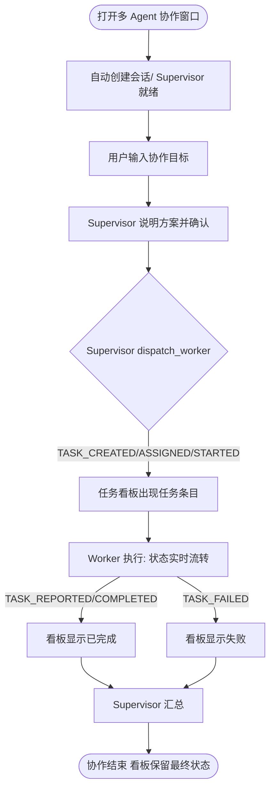
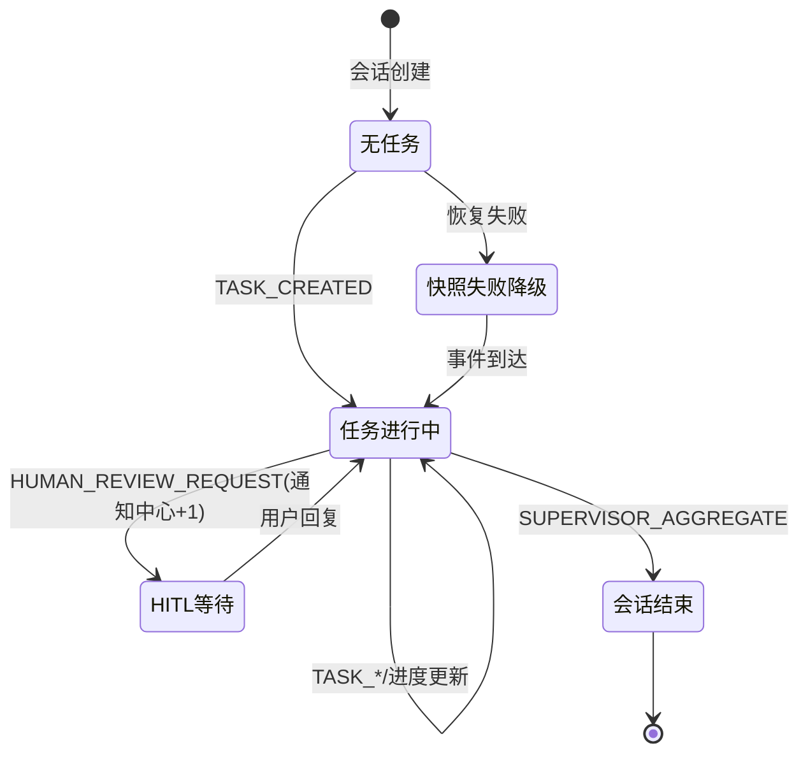

# 交互设计文档 - Story 9.44

**Story:** 多Agent协作统一任务看板（Multica模式）
**版本:** 1.0
**最后更新:** 2026-10-12

---

## 🎨 设计概览

### 设计目标

在多 Agent 协作窗口内提供 Multica 式的统一任务看板：用户发起目标后，无需翻聊天记录即可看到「哪个 Agent 负责哪个任务、进行到什么状态」。看板是聊天流的结构化投影，不是第二个操作入口（只读）。

### 参考 UX 规范

参考 [UX Design Specification](../../../_bmad-output/planning-artifacts/ux-design-specification.md) 的以下章节：
- 窗体交互（拖拽/缩放/动画过渡）
- CUI 交互（消息响应 < 500ms、Enter 发送）

---

## 🗺️ 用户流程

### 主流程



### 流程说明

#### 步骤 1: 发起目标

**触发条件:** 用户在协作窗口聊天框输入目标并发送
**用户操作:** 输入文本，Enter 发送
**系统响应:** Supervisor 回复方案说明（聊天流）；派发任务后看板出现任务条目
**下一步:** 步骤 2

#### 步骤 2: 观察任务流转

**触发条件:** 引擎发出 `TASK_*` 事件
**用户操作:** 无（被动观察）；可随时点击任务条目
**系统响应:** 看板对应任务状态标签实时更新；汇总计数同步变化
**下一步:** 步骤 3（可选联动）

#### 步骤 3: 联动查看 Agent 详情

**触发条件:** 用户点击看板中的任务条目或 Agent 名称
**用户操作:** 单击
**系统响应:** 打开该 Agent 的详情抽屉（复用 WorkerDetailDrawer，展示事件轨迹），再次点击或关闭按钮收起
**下一步:** 结束或返回步骤 2

---

## 🖼️ 界面设计

### 线框图（ASCII 示意）

```
┌──────────────────────────────────────────────────────────────┐
│ Header: [Co] 项目名 · 多Agent协作              [状态徽章]      │
├──────────────────────────────────────────────────────────────┤
│ Agent 状态条: ●产品经理 ●数据分析 ●报告撰写 …                  │
├──────────────────────────────────────────────────────────────┤
│ 任务看板（可折叠）                                             │
│ ┌──────────────────────────────────────────────────────────┐ │
│ │ 任务 3 · 活跃 1 · 已完成 1 · 失败 0            [收起 ▾]   │ │
│ │ ──────────────────────────────────────────────────────── │ │
│ │ ▶ 生成季度数据报告        数据分析Agent   ● running  10:32 │ │
│ │ ✓ 采集原始数据            数据分析Agent   ● completed 10:20│ │
│ └──────────────────────────────────────────────────────────┘ │
├───────────────────────────────┬──────────────────────────────┤
│ 聊天流（左栏 50%）              │ 拓扑图（右栏 50%，深色）        │
│ …                             │                              │
├───────────────────────────────┤                              │
│ 输入框                         │                              │
└───────────────────────────────┴──────────────────────────────┘
```

**说明：**
- 看板位于 Agent 状态条与主区（聊天+拓扑）之间，横向通栏、可折叠
- 折叠态只保留汇总条一行；展开态高度上限约 168px（约 4 行任务），超出内部滚动
- 任务行元素：状态图标、任务描述（超长截断 + title 提示）、Agent 名称、状态标签、时间

### 设计规范

- 颜色: 沿用协作窗口现有体系（看板浅色 `bg-white/gray-*`，与左栏一致；不进入深色拓扑区）
- 状态色（图标 + 文字双编码，不单靠颜色）:
  - assigned/running: `blue-600`（进行中）
  - reported: `yellow-600`（待验收）
  - completed: `green-600`
  - failed: `red-600`
- 字体: 任务描述 `text-xs font-normal`，Agent 名 `text-xs text-gray-500`
- 间距: Tailwind 4px 基准；行高 `py-1.5`，区块 `px-5 py-2`
- 组件: 无新增 shadcn 组件依赖，纯 Tailwind 组合（与 MultiAgentLauncher 现有风格一致）

---

## 🔄 交互状态

### 状态定义

#### 状态 1: 无任务（空态）

**描述:** 会话存在但 Supervisor 尚未分派任务（含 HITL 等待期）
**界面表现:** 看板折叠为汇总条 + 占位文案「暂无任务，等待 Supervisor 分派」
**可用操作:** 折叠/展开

#### 状态 2: 任务进行中

**描述:** 存在 assigned/running/reported 任务
**界面表现:** 汇总条计数实时变化；任务行按创建时间倒序；running 行状态点带 `animate-pulse`
**可用操作:** 点击行 → 打开 Agent 抽屉；折叠

#### 状态 3: 会话结束（保留态）

**描述:** `SUPERVISOR_AGGREGATE` 完成
**界面表现:** 看板保留最终任务列表与状态，不再变化
**可用操作:** 点击行回看 Agent 详情

#### 状态 4: 快照失败降级

**描述:** 会话恢复时快照接口失败
**界面表现:** 看板仅显示本次已接收事件派生的任务；不弹错误弹窗
**恢复操作:** 自动——后续事件照常驱动更新

#### 状态 5: HITL 等待（通知联动）

**描述:** Supervisor/Worker 发起人工确认（`HUMAN_REVIEW_REQUEST`），协作挂起
**界面表现:**
- 协作窗口：HITL 输入卡出现（现有行为，零改动）
- 通知中心：新增一条「多 Agent 协作等待回复」系统通知（≤30s 轮询可见，未读计数 +1）
**用户操作:** 在协作窗口回复；或先通过通知感知，再切回协作窗口处理

### 状态转换图



---

## ⚠️ 错误处理

### 错误类型 1: 快照接口失败

**触发条件:** IPC invoke 拒绝 / HTTP 非 200 / fetch 网络异常
**错误提示:** 不打断用户；`console.error("[MultiAgentLauncher] Get task snapshot failed:", …)`
**提示位置:** 仅控制台
**提示样式:** 无 UI 提示（降级可用的场景不制造焦虑）
**用户操作:** 无需操作，看板以事件流数据继续工作

### 错误类型 2: 事件流断连

**触发条件:** SSE 断开 / IPC 事件中断
**错误提示:** 沿用协作窗口现有断连处理（store `isConnected` 机制，本 Story 不改动）
**用户操作:** 现有重连机制恢复后，看板通过增量事件 + 兜底快照对账补齐

---

## ♿ 可访问性设计

### 键盘导航

| 按键 | 功能 |
|------|------|
| Tab | 焦点在看板行间移动 |
| Enter | 激活聚焦行（打开 Agent 抽屉） |
| Esc | 关闭抽屉 |

### 屏幕阅读器支持

- **ARIA 标签:** 看板容器 `role="region" aria-label="任务看板"`；任务行 `aria-label="任务 {描述}，负责 {Agent}，状态 {状态}"`
- **语义化 HTML:** 任务列表用 `ul/li`，状态用文本而非仅色点
- **焦点管理:** 抽屉打开时焦点移入，关闭时回到触发行
- **状态通知:** 汇总计数变化通过文本更新自然播报（不额外加 aria-live，避免高频打断）

### 颜色对比度

- **文本对比度:** 符合 WCAG AA (4.5:1)——状态文字使用 600 色阶
- **非文本对比度:** 状态图标附文字标签，不单靠颜色

### 触摸目标

- 任务行整行可点击，高度 ≥ 32px

---

## 📱 响应式设计

### 桌面端 (>= 1920px)

**布局:** 看板通栏展开，任务行完整显示描述+Agent+状态+时间
**特殊处理:** 无

### 平板端 (768px - 1919px)

**布局:** 看板默认展开，时间列在 < 1024px 时隐藏
**特殊处理:** 描述截断长度随宽度自适应（CSS 截断）

### 移动端 (< 768px)

**布局:** 看板默认折叠为汇总条
**特殊处理:** MVP 主要优化桌面端；移动端保持可折叠即可

---

## 🎬 动画和过渡

### 动画 1: 看板折叠/展开

**触发时机:** 点击汇总条折叠按钮
**动画效果:** 高度过渡（grid-template-rows 或 max-height）
**持续时间:** 200ms
**缓动函数:** ease-in-out

### 动画 2: 新任务行进入

**触发时机:** `TASK_CREATED` 事件到达
**动画效果:** 行淡入 + 轻微上移（opacity + translateY）
**持续时间:** 150ms

**性能考虑:**
- 仅使用 CSS transform 和 opacity
- 避免触发 layout 和 paint
- 不对长列表逐行加动画（>20 行时关闭入场动画）

---

## 📐 设计规范

### 组件使用

| 组件 | 来源 | 用途 |
|------|------|------|
| TaskBoard（新增） | collaboration-runtime/ui | 任务列表 + 汇总条 |
| WorkerDetailDrawer（复用） | collaboration-runtime/ui | Agent 详情联动 |
| AgentStatusBar（复用） | collaboration-runtime/ui | Agent 状态点 |

### 样式规范

**颜色：**
- 主色: `blue-600`（进行中）
- 成功: `green-600`
- 警告: `yellow-600`（待验收）
- 错误: `red-600`

**字体：**
- 标题: `text-xs font-semibold`
- 正文: `text-xs font-normal`
- 辅助: `text-[10px] text-gray-400`（时间戳，符合现有消息时间戳风格）

**间距：**
- 使用 Tailwind 间距系统 (4px 基准)

---

## 🔍 设计审查

### 审查清单

- [x] 用户流程完整
- [x] 交互状态定义清晰
- [x] 错误处理已设计
- [x] 可访问性已考虑
- [x] 响应式设计已规划
- [x] 动画性能已优化
- [x] 符合 UX 设计规范（协作窗口现有风格）
- [x] 组件使用符合规范（纯 Tailwind，无越界依赖）

### 审查记录

| 日期 | 审查人 | 结果 | 备注 |
|------|--------|------|------|
| 2026-10-12 | TBD | 🔄 Needs Revision | 待用户评审 |

---

## 📎 设计资源

### 文件清单

- 线框图：本文件 ASCII 示意（MVP 不绘制高保真图）
- 流程图：见「用户流程」Mermaid

### 设计工具

- **流程图工具:** Mermaid
- **图标库:** lucide-react（沿用 MultiAgentLauncher 现有依赖）

---

## 📌 相关文档

- [Story README](./README.md)
- [需求文档](./requirements.md)
- [架构设计](./architecture.md)
- [UX Design Specification](../../../_bmad-output/planning-artifacts/ux-design-specification.md)
